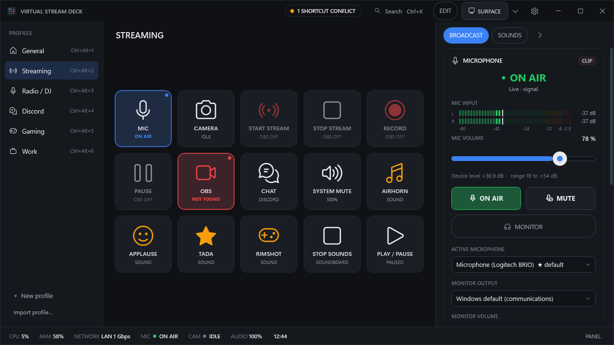

# Virtual Stream Deck & Soundboard

**Turn any Windows screen — a second monitor, a touchscreen, a tablet, or the one you're using — into a programmable control surface.**
Buttons for apps, shortcuts, macros, microphone and camera, media, power and OBS; an Internet‑radio style broadcast console with a real mic meter; and a soundboard. It all ships as one portable `VirtualStreamDeck.exe`.

- Windows 10 (1809+) / 11, x64 · no installer, no runtime to install, no admin rights, no account, no cloud
- Copy the exe to another PC and run it. Settings live in `%APPDATA%\VirtualStreamDeck`; nothing is written next to the exe.

## Download

Get `VirtualStreamDeck.exe` from the **Releases** page and run it. On first launch a four‑step wizard asks where you'll press the buttons, which grid you want and which profiles to start with.



## Features

| Area | What it does |
|---|---|
| **Button grid** | 3×3 · 4×3 · 5×3 · 5×4 · 6×4 · 8×4 (per profile, several pages each). Keys scale from 1280×720 to 4K and portrait. 1×1, 2‑wide, 2‑tall and 2×2 keys. |
| **Buttons** | Icon (built‑in glyph library, emoji, text or your own image), title, subtitle, background / accent / text colour, press sound, global shortcut, confirmation. Standard, **momentary** (key held while you hold the button — push‑to‑talk), **toggle** and **multi‑state** buttons. |
| **Actions** | Launch app (with arguments, working folder, focus‑if‑running, run as admin) · open URL · open file/folder · keyboard shortcut (CTRL/ALT/SHIFT/WIN, F13–F24…) · macro (keys, text, waits, mouse click/move, launch) · type text · media · system · power · deck navigation · OBS · Discord · user‑defined command/script (clearly marked). |
| **Broadcast mic** | ON AIR / MUTED / NO DEVICE, real per‑channel input meter in dBFS with low / normal / high / clip zones, peak hold and a clip lamp, a touch‑sized volume fader (drag, tap, wheel, arrows), the device's dB level and range, device switcher, **mic monitoring** through any output, remembered volume per microphone, disconnect / reconnect detection. |
| **Soundboard** | WAV, MP3, OGG, FLAC, AIFF, WMA, M4A. Many sounds at once, volume, loop, fade in/out, overlap / restart / stop‑on‑retrigger, playback progress on the key, own output device (e.g. a virtual cable into OBS/Discord), eight synthesised built‑in sounds, drag‑and‑drop import. |
| **System** | Master volume / mute, mic mute & volume, default output/input device, brightness (laptop panels via WMI, external monitors via DDC/CI), Wi‑Fi and Bluetooth radios, camera status, lock / sleep / hibernate / restart / shut down / sign out (destructive ones always ask). |
| **Profiles** | General, Streaming, Radio / DJ, Discord, Gaming, Work, Presentation, Music, Custom. Create, duplicate, reorder, import/export, drag buttons between pages and profiles. **Auto‑profile** by foreground app (e.g. `obs64.exe → Streaming`). |
| **Control surface** | Full‑screen on any display, remembered, falls back if the monitor is unplugged. Never steals focus (so shortcuts reach your app), touch‑first, cursor auto‑hide, keeps the screen awake, press‑and‑hold to exit. Optional broadcast console beside the keys. |
| **Tablet remote** | Optional: any tablet/phone browser on your LAN becomes a surface. PIN‑protected, off by default, no app, no cloud. |
| **Everywhere** | Global hotkeys with conflict reporting, tray menu, Ctrl+K command search, full keyboard navigation, in‑app notifications, diagnostics with *Copy Diagnostics*, complete export/import (sounds and icons included, secrets excluded). |

## What is real and what Windows doesn't allow

Every visible control does something real. Where Windows offers no reliable API, the app says so instead of faking a state:

| Feature | How it works |
|---|---|
| Microphone mute / volume / meter | Core Audio endpoint (same as Windows Sound settings); the meter reads the actual capture stream. While metering, Windows shows its microphone‑in‑use icon — that's correct. |
| Mic monitoring | A low‑latency WASAPI stream from the mic to the chosen output (~40–60 ms, shared mode). Use headphones. |
| Camera | Shows whether an app is using the camera right now and whether camera access is blocked (the data behind Windows' privacy indicator). There is no supported API to switch a webcam off, so the camera button opens the camera privacy page. A separate action disables/enables the camera device in Device Manager — a real cut‑off that needs a UAC prompt each time. |
| Default audio device | Windows has no documented API; the app uses the `IPolicyConfig` interface the Sound control panel itself uses. |
| Discord mute/deafen | Discord has no local API without a cloud‑registered app, so these buttons send *your* Discord keybind and don't claim to know Discord's state. Launch/focus works directly. |
| Night light | No public API — the button opens the Night light settings page. |
| Per‑app audio routing | Soundboard sounds play on one chosen device. To feed them into OBS/Discord, choose a virtual cable (VB‑CABLE, VoiceMeeter) as the soundboard output. |
| Brightness | Works on panels that expose WMI brightness and monitors with DDC/CI enabled; others are reported as unsupported. |
| Keys into elevated apps | Windows blocks simulated input into apps running as administrator (UIPI) unless this app is elevated too. |

## Using it

- **Edit mode** (`EDIT` or Ctrl+E): click a key to edit it, drag keys to swap/move, drop onto a profile in the sidebar or a page tab to move it there, `+` to add. Drag a sound from the library onto the grid to make a sound key.
- **Control surface**: `SURFACE` (or F11 / Ctrl+Alt+S), `▾` to pick a display. Hold the ✕ to close it.
- **Keys**: Ctrl+K search · Ctrl+1…9 profiles · PageUp/PageDown pages · arrows + Enter to press · Esc leaves edit mode.
- Default global shortcuts: Ctrl+Alt+1…9 profiles, Ctrl+Alt+M microphone, Ctrl+Alt+S surface, Ctrl+Alt+X stop sounds (change them in Settings › Hotkeys).

## Building from source

Requirements: Windows, .NET 8 SDK.

```powershell
dotnet test tests\VirtualStreamDeck.Tests -p:Platform=x64
powershell -ExecutionPolicy Bypass -File scripts\publish.ps1     # -> Release\VirtualStreamDeck.exe
```

`publish.ps1` runs the unit tests, publishes a self‑contained single file, fails if anything besides the exe is produced, writes `SHA256SUMS.txt`, and runs the exe's built‑in self‑test.

The exe has a headless self‑test that exercises the real system without touching your settings (throwaway data folder, silent audio, no keystrokes sent to other apps):

```powershell
Release\VirtualStreamDeck.exe --verify --out report.txt --shots shots\
```

Other switches: `--data <folder>` (use another data folder), `--minimized`, `--surface`.

## Tech

.NET 8 WPF, published self‑contained single‑file (no trimming — WPF isn't trim‑safe). Dependencies are embedded: NAudio (WASAPI / Media Foundation), NVorbis (OGG), System.Management (WMI), the Windows SDK projection (radios, media session). Everything else — hotkeys, SendInput, tray, DDC/CI, DPAPI, the OBS WebSocket v5 client and the tiny HTTP server for the tablet — is written against Win32 directly. See [docs/ARCHITECTURE.md](docs/ARCHITECTURE.md).

## License

MIT — see [LICENSE](LICENSE).
